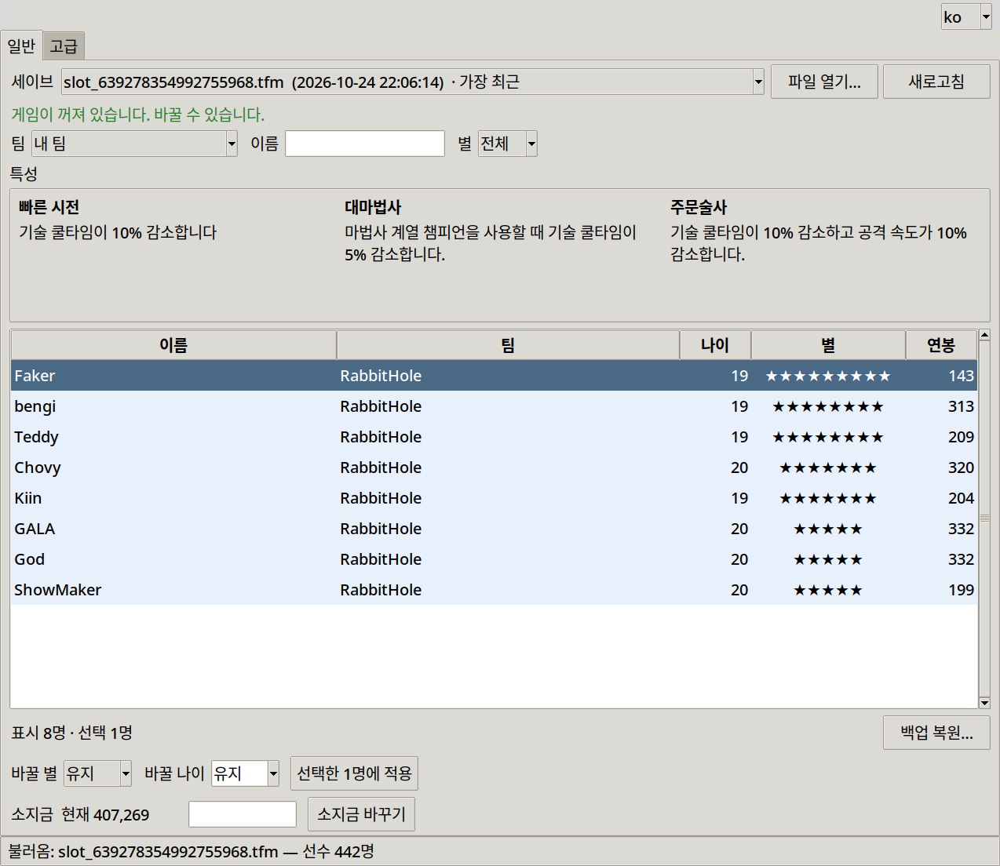
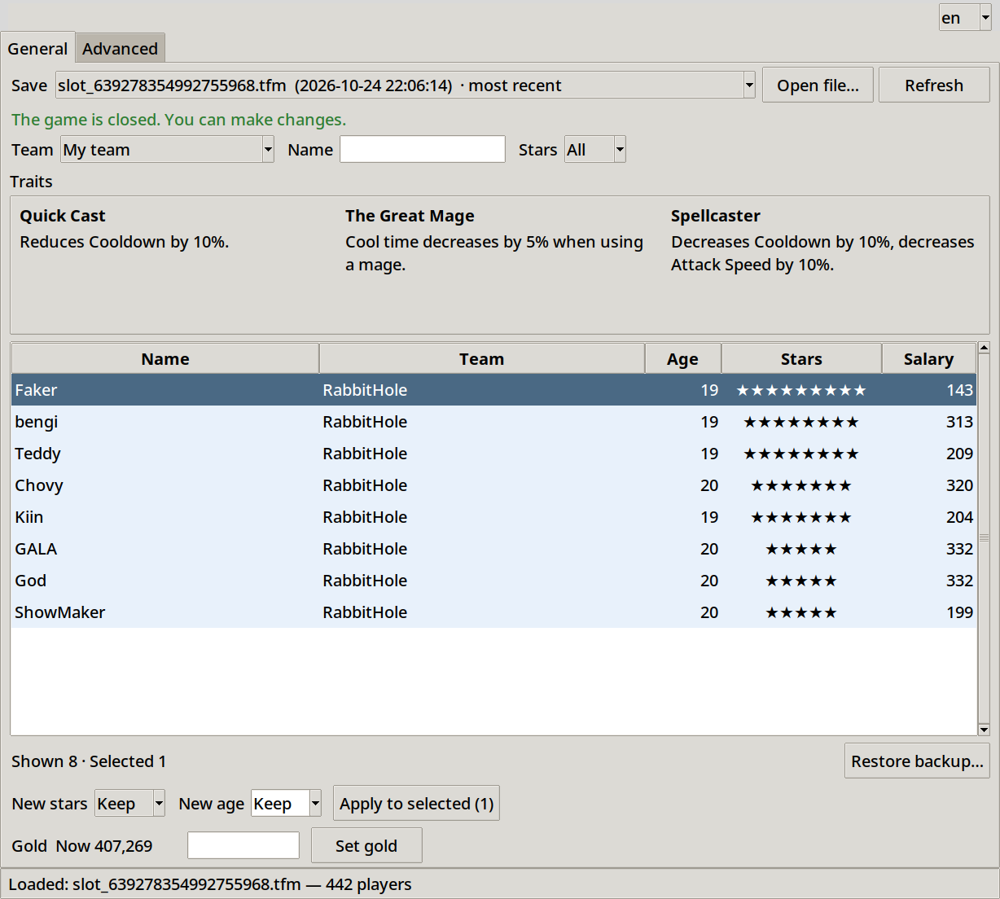
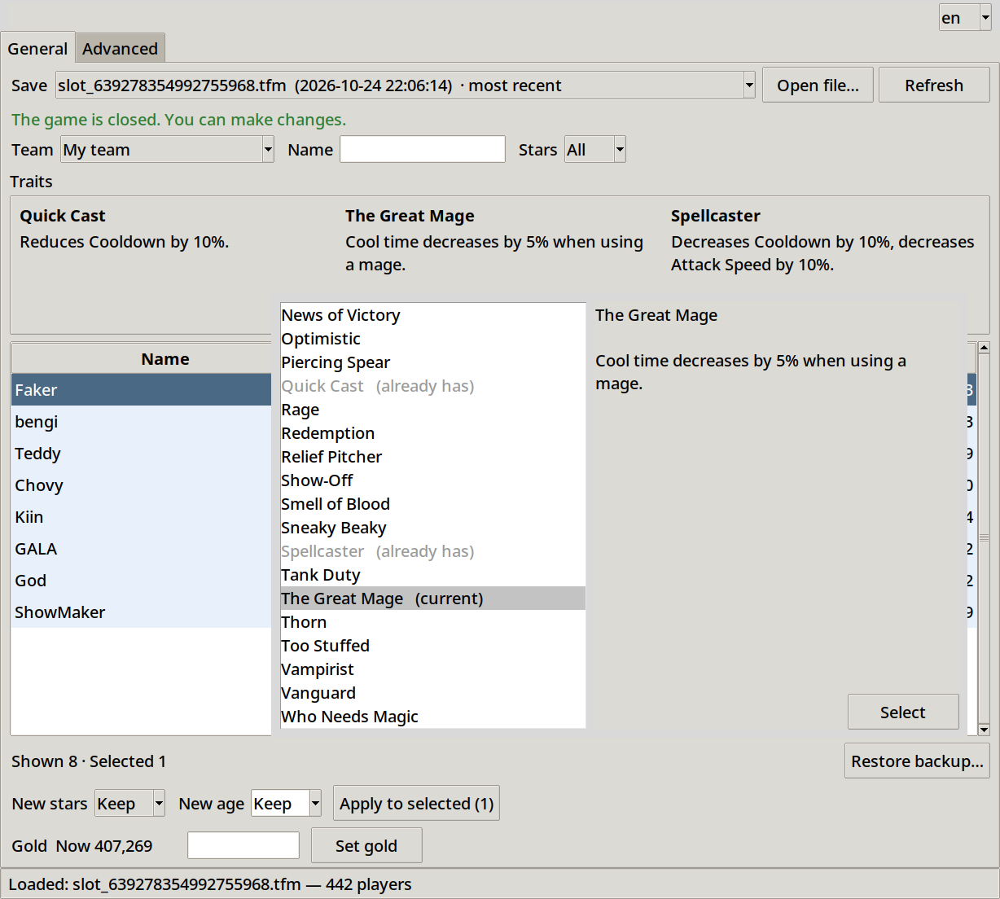
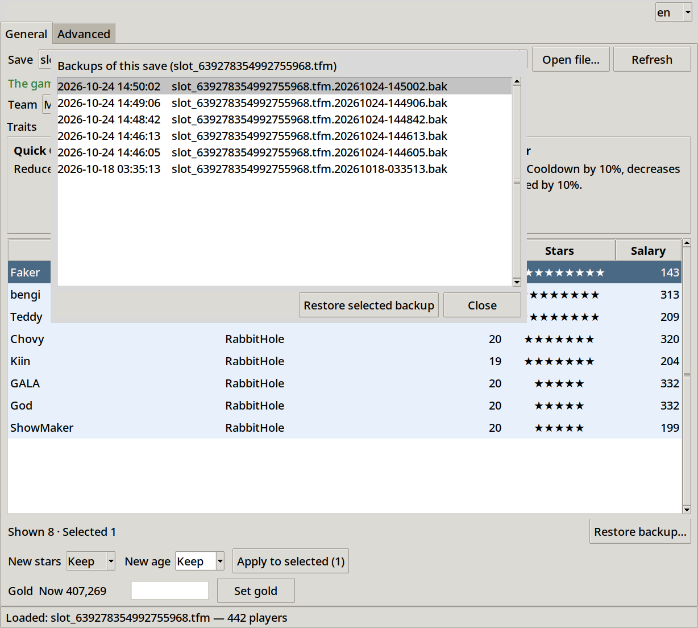
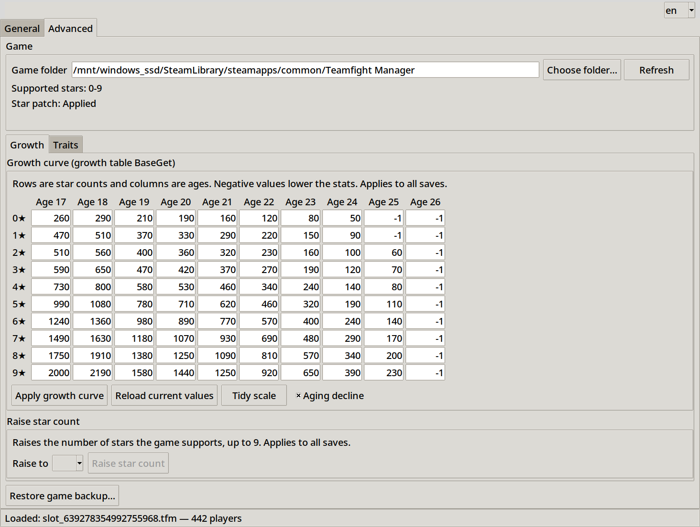
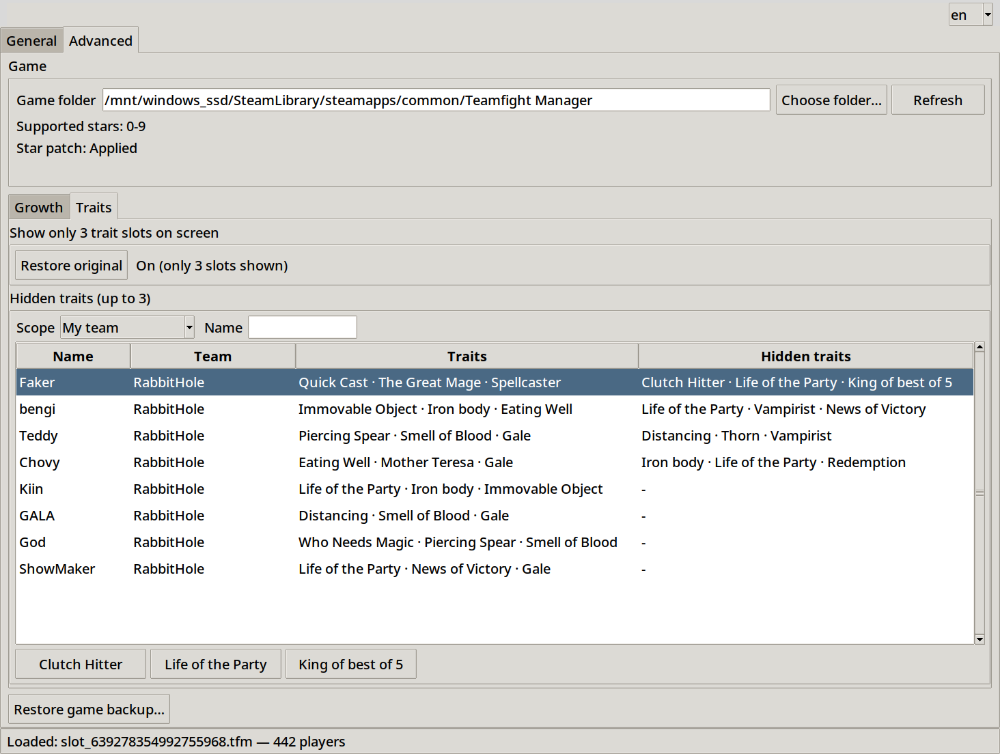

# Screens and features

A tour of the program, one screen per feature. The screenshots use the English interface.

## Language

Pick `ko` or `en` in the top right corner. Everything switches at once, including trait names and descriptions, and the choice is remembered.

## General tab

Pick a save at the top, then narrow the list by team, name or stars. Select one or more players, choose New stars and New age, and press Apply to selected. Gold is set at the bottom. Leave a field on Keep to leave that value alone.

The three traits of a single selected player are shown in the Traits box.

## Changing traits

Select one player and click one of the trait cards. Pick the new trait from the list on the left, read its description on the right, and press Select. Traits the player already has are greyed out. The card after the last trait adds a new slot.

## Restoring a backup

Every change copies the save into the backups folder first. Restore backup lists the backups of the loaded save. The state just before a restore is kept too, so a restore can be undone.

## Advanced: growth curve and star count

Rows are star counts and columns are ages. Edit the cells and press Apply growth curve. A negative value lowers a stat instead of raising it. Raise star count adds the stars you pick, up to 9, so that players with 4 or more stars work. These change game files and apply to every save.

## Advanced: hidden traits

Select a player who has 3 traits and use the buttons below the list to set or add a hidden trait (up to 3). Show only 3 slots stops the game screens from drawing more than 3 traits; it is turned on automatically the first time you set a hidden trait.

